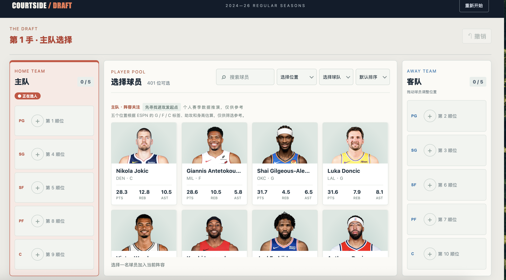
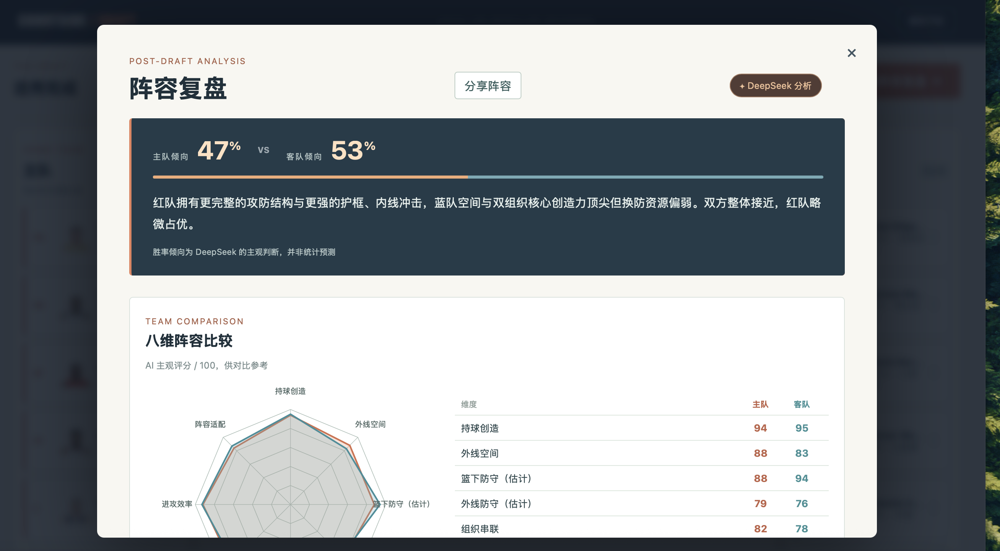
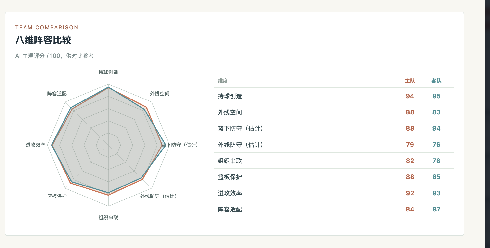
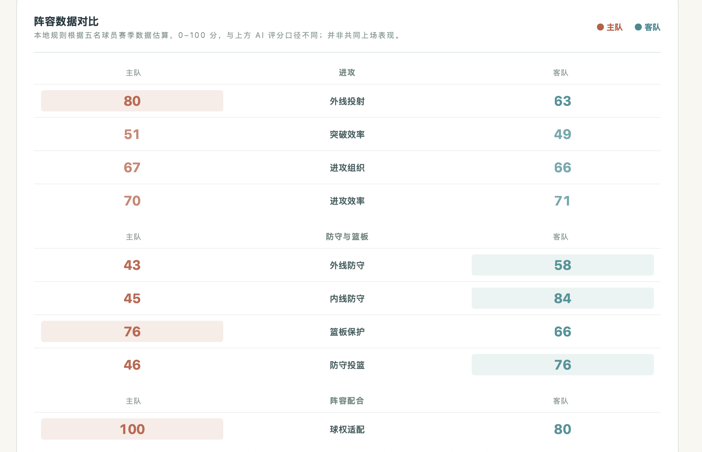
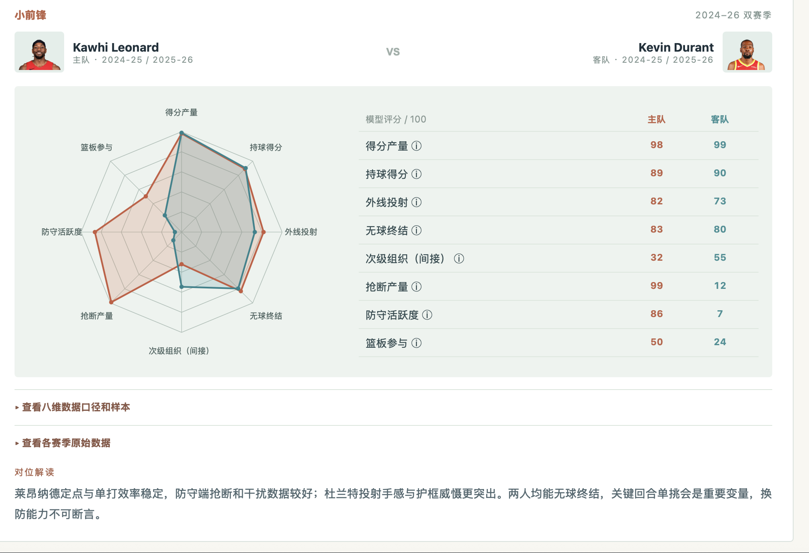

# COURTSIDE / DRAFT — NBA 阵容选秀模拟器

一个 NBA 阵容选秀模拟器，支持普通选秀、BP 禁选、人机对战和阵容复盘，基于球员赛季数据分析位置对位与阵容适配。

## 如何使用

### 1. 选择对战模式

在首页选择 **双人对战**，与朋友轮流操作；或选择 **挑战 AI**，与智能对手对战。选择主队或客队，并根据需要开启「禁选模式」，然后点击 **开始选秀**。主队为红色、客队为蓝色。


### 2. 可选：BP 禁选模式

开启禁选模式后，页面顶部会显示双方禁用的球员。被禁用的球员不能再被选择；双方各禁用 5 人、各选择 5 人。以主队先手为例，完整顺序如下：

| 阶段 | 操作顺序 |
| --- | --- |
| 第一轮禁用 | 主队禁 1 人 → 客队禁 1 人 → 主队禁 1 人 → 客队禁 1 人 |
| 第一轮选人 | 主队选 1 人 → 客队选 2 人 → 主队选 2 人 → 客队选 1 人 |
| 第二轮禁用 | 主队禁 1 人 → 客队禁 2 人 → 主队禁 2 人 → 客队禁 1 人 |
| 第二轮选人 | 主队选 1 人 → 客队选 2 人 → 主队选 1 人 |


不开启禁选模式时，直接进入普通选秀。两种模式的选人、调整位置和复盘方式相同。

### 3. 选择球员

普通选秀采用蛇形顺序：**主队选 1 人 → 客队选 2 人 → 主队选 2 人 → 客队选 2 人 → 主队选 2 人 → 客队选 1 人**，直到双方各选满 5 人。页面会高亮当前操作的队伍；点击球员卡片即可选择，也可以搜索球员、按位置或球队筛选。选错时可使用「撤销」。



### 4. 调整首发位置

选人过程中或选秀完成后，可以拖动已选球员调整顺序；触屏设备也可使用位置调整按钮。双方从上到下依次为**控球后卫 PG、得分后卫 SG、小前锋 SF、大前锋 PF、中锋 C**。复盘中的位置对比以这里排定的顺序为准。调整完成后，点击 **查看阵容复盘**。


### 5. 查看阵容复盘

**综合判断**：复盘顶部展示双方的阵容倾向和简要分析，也可以生成分享阵容卡。使用 DeepSeek 时，倾向是模型的主观判断，不是统计意义上的比赛胜率预测；服务不可用时使用本地结果。



**八维阵容比较**：用雷达图和表格展示双方在持球创造、外线空间、篮下防守、外线防守、组织串联、篮板保护、进攻效率和阵容适配上的主观评分，方便快速比较。



**球队分析**：分别查看两队的阵容分工、优势、劣势和假设的极限情境；还可以展开阵容分工参考。这些内容是基于球员数据的推演，不代表五人实际共同上场的表现。


**阵容数据对比**：从进攻、防守与篮板、阵容配合等方面比较本地模型评分。它与上方 AI 主观评分的计算口径不同；可展开页面中的评分依据了解数据。



**五个位置的模拟对位**：按照手动排定的位置逐一比较双方球员。不同位置使用相应的八维指标，并提供对位解读；可展开查看指标口径、样本和各赛季原始数据。评分是相对于球员组的数据模型结果，不是官方能力值，也不等于实际比赛中的防守对位。


<details>
<summary>查看其他四个位置的对位示例</summary>

**得分后卫**


**小前锋**



**大前锋**


**中锋**


</details>

## 本地运行

需要 Node.js。安装依赖并启动开发服务：

```bash
npm install
npm run dev
```

在浏览器打开 `http://127.0.0.1:5188`；本地 API 使用 3018 端口。运行 `npm run build` 后，可用 `npm run start` 启动生产服务。`npm test` 运行单元测试；启动开发服务后，`npm run test:ui` 运行浏览器测试（需要本机 Chrome）。

DeepSeek 为可选功能：在项目根目录的 `.env` 中设置 `DEEPSEEK_API_KEY=你的密钥`，密钥仅供服务端使用，不要提交到公开仓库。未配置或调用失败时使用本地分析。运行 `npm run players:fetch` 可刷新球员快照。

## 数据与评分说明

球员基础数据和头像来自 ESPN；可取得统计且至少一个赛季出场 20 场、场均至少 15 分钟的球员进入球员池，不保证覆盖所有球员。球队信息以赛季资料为准。

当前球员池覆盖 2024–25 和 2025–26 常规赛：至少一个赛季出场 20 场且场均 15 分钟。双赛季基本权重分别为 35% 和 65%，不足 20 场的赛季按场次比例降低权重后重新归一化；只出现一个赛季时使用该赛季。得分、篮板、助攻、盖帽、抢断、失误与 PER 为加权赛季值，TS% 使用加权场均得分、出手和罚球出手计算。复盘可展开各赛季原始数据。默认综合排序依照 PER、ESPN 综合评分与上场时间计算，属于数据模型，不是官方能力值。

中锋对位图的“内线战术进攻”使用 [sportsdataverse NBA Synergy 快照](https://github.com/sportsdataverse/sportsdataverse-data/releases/tag/nba_stats_synergy)的顺下、低位、空切回合；“篮下防守（追踪）”使用 [NBA 防守追踪缓存](https://github.com/maxhostetter-eng/nba-defensive-shot-tracking-analysis) 的篮下防守命中率差，并不等于协防能力。合并两季时沿用球员赛季权重，有数据的赛季重新归一化；战术每季至少30回合，防守每季至少20场及50次篮下防守出手。当前覆盖分别为301/401、398/401；不同球员可用赛季不同，界面显示样本。刷新数据需 Python 的 pyarrow 后运行 `python3 scripts/import-tracking.py`，遇缺失不填零。

位置图的掩护助攻、干扰投篮、传球干扰和争抢球来自 [NBA Hustle 数据快照](https://github.com/sportsdataverse/sportsdataverse-data/releases/tag/nba_stats_hustle)，使用 2024–25 与 2025–26 常规赛。`python3 scripts/import-hustle.py` 需要 pyarrow；以姓名、NBA ID 唯一性与各赛季出场数核验，累计至少20场且出场数与 ESPN 差不超过1场，交易球员按球队行合计。当前匹配 327/401 人；缺失维度不参与评分。数据按实际可用赛季的权重归一化，以每36分钟展示。不同角色基准使用 ESPN G/F/C 三组，不是精确的五位置分组，每项至少20个有效同组样本。

### 追踪数据核对与限制

突破、潜在助攻与防守投篮数据来自 NBA_Lineup202324_Analyzer 的 NBA 统计镜像，文件版本由 `scripts/import-external-tracking.py` 中的 Git blob SHA 固定。导入时按规范化姓名匹配，要求 ESPN 球员池姓名唯一、跨赛季及追踪来源的 NBA ID 唯一；逐赛季常规赛出场数须与 ESPN 相差不超过 1 场。转队时仅在分球队记录的场次总和吻合时合并；不满足条件的赛季不使用，不能当作零。权重按有数据的赛季重新归一，每项保留赛季、样本和原始权重。NBA ID 仍为姓名匹配的候选映射，尚未与官方身份表逐人确认；有数据不等于样本覆盖完整赛季。

快照抽查：库里、东契奇、文班亚马、哈利伯顿的 ESPN 出场数和得分与对应赛季 ESPN 接口一致；东契奇涉及转队，哈利伯顿仅有一个赛季。该抽查不构成 NBA 官网逐人或逐项数据对账。突破、外线防守等追踪结果仍需官方来源独立验证；球队防守投篮是个人数据推演，不是五人实际共同上场的防守效率。

### 项目声明

本项目为个人学习和非商业用途的非官方篮球选秀模拟器，与 NBA、ESPN、球队及球员无官方关联。球员头像、姓名、球队标识及第三方数据的相关权利归各自权利人所有；标注来源或非商业声明不构成授权，第三方素材的使用和再分发应自行核实许可。
