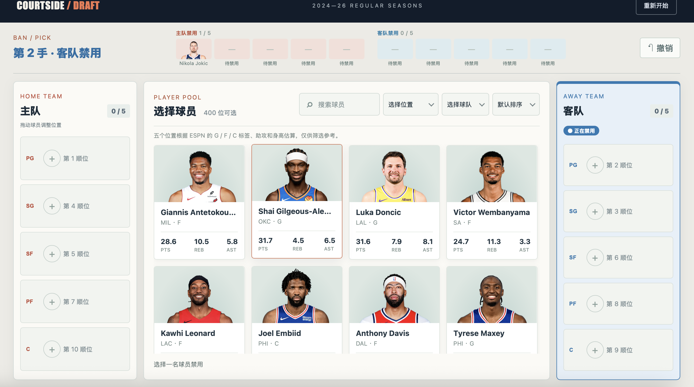
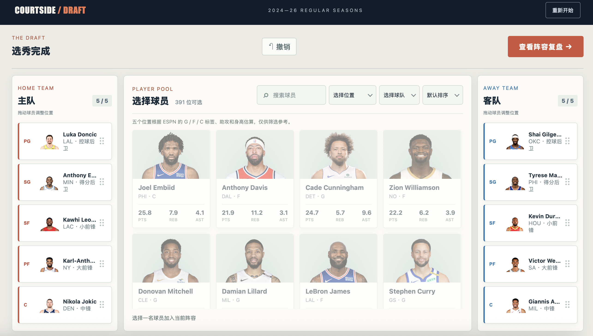
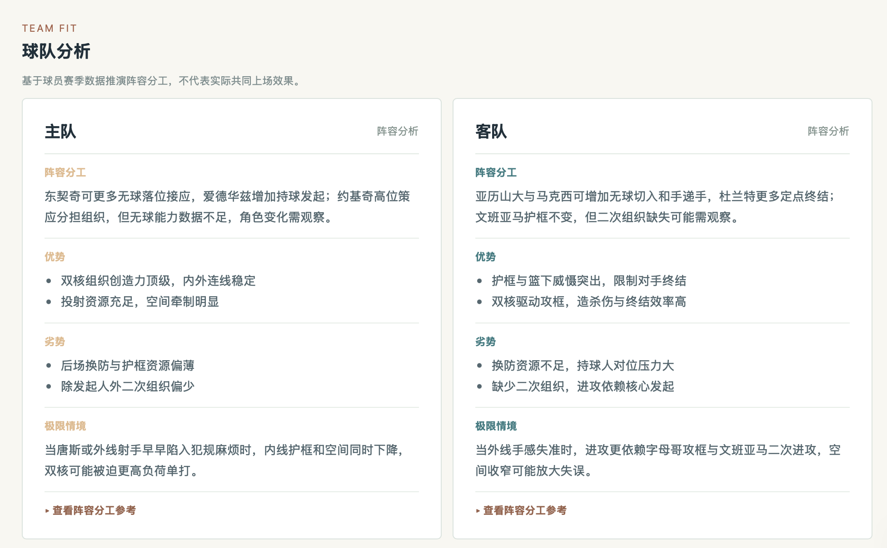
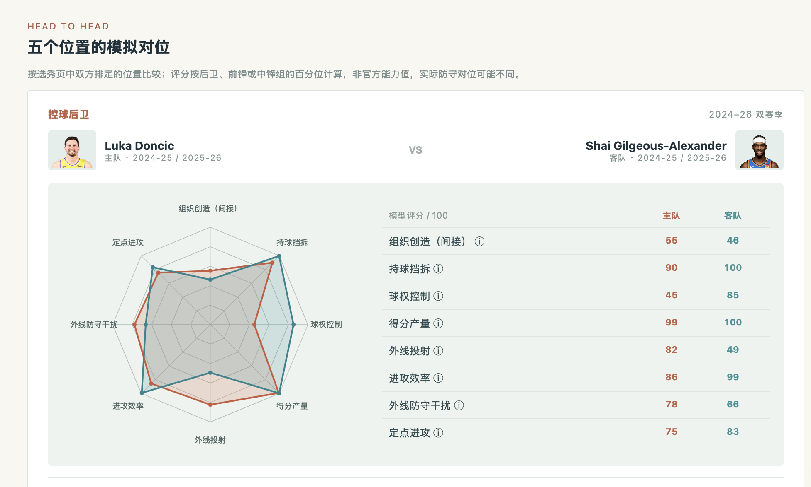
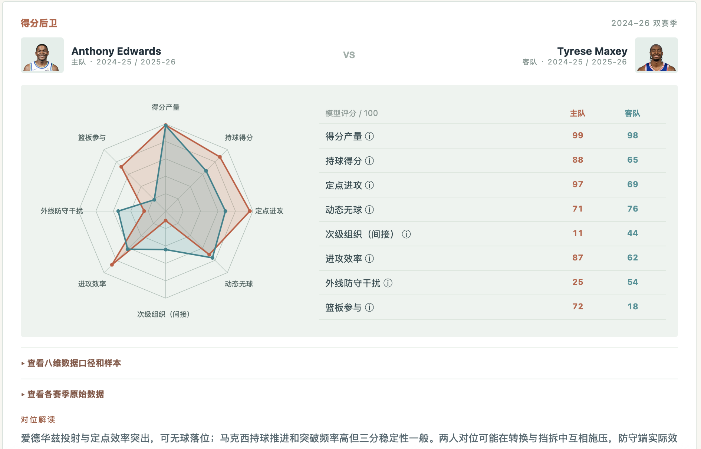
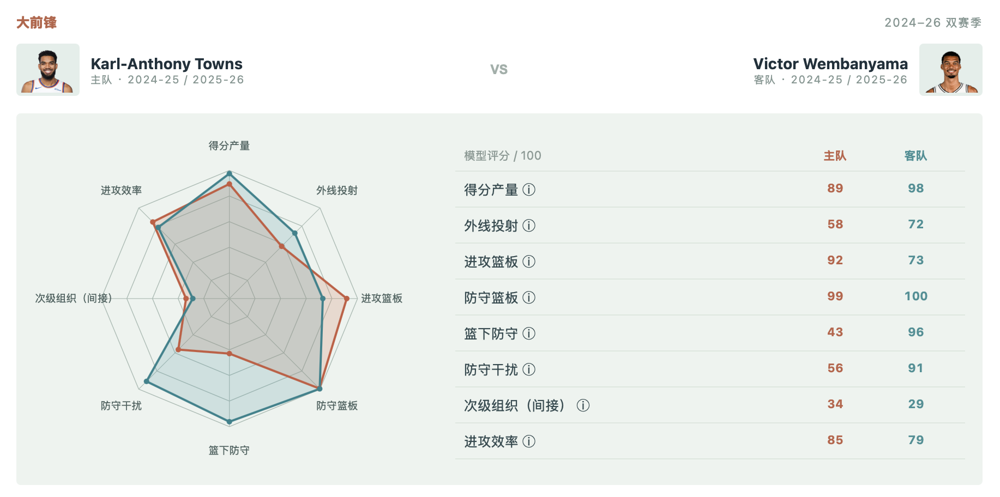
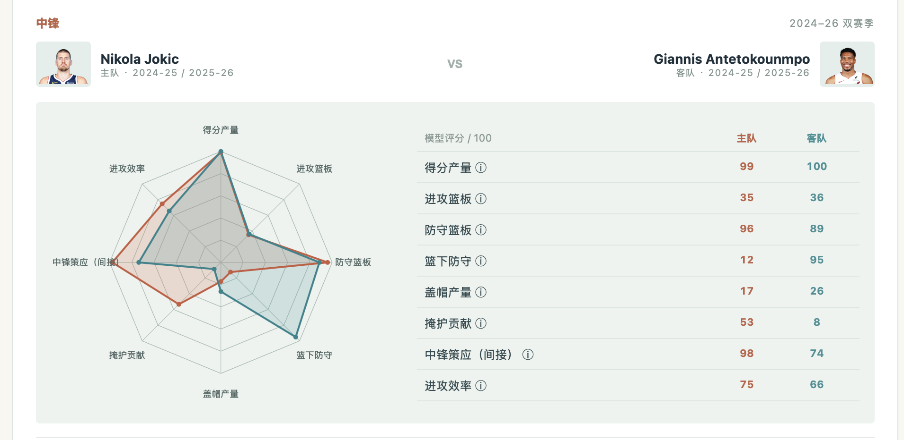

# COURTSIDE / DRAFT — NBA 阵容选秀模拟器

一个 NBA 阵容选秀模拟器，支持普通选秀、BP 禁选、人机对战和阵容复盘，基于球员赛季数据分析位置对位与阵容适配。

## 如何使用

### 1. 选择对战模式

在首页选择 **双人对战**，与朋友轮流操作；或选择 **挑战 AI**，与智能对手对战。选择主队或客队，并根据需要开启「禁选模式」，然后点击 **开始选秀**。主队为红色、客队为蓝色。


### 2. 可选：BP 禁选模式

开启禁选模式后，页面顶部会显示双方禁用的球员。被禁用的球员不能再被选择；双方各禁用 5 人、各选择 5 人。以主队先手为例，完整顺序如下：

| 阶段 | 操作顺序 |
| --- | --- |
| 第一轮禁用 | 主队禁 1 人 → 客队禁 1 人 → 主队禁 1 人 → 客队禁 1 人 |
| 第一轮选人 | 主队选 1 人 → 客队选 2 人 → 主队选 2 人 → 客队选 1 人 |
| 第二轮禁用 | 主队禁 1 人 → 客队禁 2 人 → 主队禁 2 人 → 客队禁 1 人 |
| 第二轮选人 | 主队选 1 人 → 客队选 2 人 → 主队选 1 人 |



不开启禁选模式时，直接进入普通选秀。两种模式的选人、调整位置和复盘方式相同。

### 3. 选择球员

普通选秀采用蛇形顺序：**主队选 1 人 → 客队选 2 人 → 主队选 2 人 → 客队选 2 人 → 主队选 2 人 → 客队选 1 人**，直到双方各选满 5 人。页面会高亮当前操作的队伍；点击球员卡片即可选择，也可以搜索球员、按位置或球队筛选。选错时可使用「撤销」。


### 4. 调整首发位置

选人过程中或选秀完成后，可以拖动已选球员调整顺序；触屏设备也可使用位置调整按钮。双方从上到下依次为**控球后卫 PG、得分后卫 SG、小前锋 SF、大前锋 PF、中锋 C**。复盘中的位置对比以这里排定的顺序为准。调整完成后，点击 **查看阵容复盘**。



### 5. 查看阵容复盘

**综合判断**：复盘顶部展示双方的阵容倾向和简要分析，也可以生成分享阵容卡。使用 DeepSeek 时，倾向是模型的主观判断，不是统计意义上的比赛胜率预测；服务不可用时使用本地结果。


**八维阵容比较**：用雷达图和表格展示双方在持球创造、外线空间、篮下防守、外线防守、组织串联、篮板保护、进攻效率和阵容适配上的主观评分，方便快速比较。


**球队分析**：分别查看两队的阵容分工、优势、劣势和假设的极限情境；还可以展开阵容分工参考。这些内容是基于球员数据的推演，不代表五人实际共同上场的表现。



**阵容数据对比**：从进攻、防守与篮板、阵容配合等方面比较本地模型评分。它与上方 AI 主观评分的计算口径不同；可展开页面中的评分依据了解数据。


**五个位置的模拟对位**：按照手动排定的位置逐一比较双方球员。不同位置使用相应的八维指标，并提供对位解读；可展开查看指标口径、样本和各赛季原始数据。评分是相对于球员组的数据模型结果，不是官方能力值，也不等于实际比赛中的防守对位。



<details>
<summary>查看其他四个位置的对位示例</summary>

**得分后卫**



**小前锋**


**大前锋**



**中锋**



</details>

## 本地运行

### 1. 安装并启动

建议使用 Node.js 20.12 或更高版本。在项目目录中依次运行：

```bash
npm install
npm run dev
```

打开浏览器访问 [http://127.0.0.1:5188](http://127.0.0.1:5188)。开发模式下，本地 API 使用 3018 端口。

### 2. 配置 AI 复盘（可选）

想使用 DeepSeek 分析时，在项目根目录创建 `.env` 文件，填入自己的 API Key：

```env
DEEPSEEK_API_KEY=你的密钥
```

保存后重启服务。密钥由服务端读取，请勿提交到公开仓库。没有配置密钥或调用失败时，仍可选秀并使用本地规则复盘。

### 3. 其他常用命令

| 命令 | 用途 |
| --- | --- |
| `npm run build` | 构建生产版本 |
| `npm run start` | 启动生产服务，默认使用 3018 端口 |
| `npm test` | 运行单元测试 |
| `npm run test:ui` | 运行浏览器测试；需先启动开发服务并安装 Chrome |
| `npm run players:fetch` | 刷新球员数据快照 |

## 数据与评分说明

### 球员数据

- **赛季范围**：2024–25 和 2025–26 常规赛。球员至少在其中一个赛季出场 20 场、场均上场 15 分钟，且能取得统计数据，才会进入球员池；不保证覆盖全部球员。
- **基础数据和头像**：来自 ESPN；球队信息以赛季资料为准。
- **双赛季权重**：2024–25 占 35%，2025–26 占 65%。不足 20 场的赛季按出场数降低权重并重新归一；只有一个赛季有数据时使用该赛季。
- **统计口径**：得分、篮板、助攻、盖帽、抢断、失误和 PER 使用加权赛季值；真实命中率（TS%）由加权得分、出手和罚球出手计算。复盘中可展开各赛季原始数据。
- **默认排序**：根据 PER、ESPN 综合评分和上场时间计算，是项目的数据模型，并非官方能力值。

### 复盘评分如何理解

阵容分析是根据球员个人赛季数据进行的推演，不代表五人实际共同上场的表现。AI 生成的比赛倾向是主观判断，不是统计预测；本地阵容数据对比与 AI 阵容评分使用不同口径。

球员对位评分以 ESPN 的后卫、前锋和中锋组作为比较基准，并非精确的五位置分组。追踪数据不足时，相应维度不填零，也不参与评分；不同球员的可用赛季和样本可能不同，可在复盘中展开查看。

<details>
<summary>查看追踪数据来源、导入和样本限制</summary>

**战术和篮下防守**

- 中锋的内线战术进攻使用 [sportsdataverse NBA Synergy 快照](https://github.com/sportsdataverse/sportsdataverse-data/releases/tag/nba_stats_synergy)中的顺下、低位和空切回合。
- 篮下防守使用 [NBA 防守追踪缓存](https://github.com/maxhostetter-eng/nba-defensive-shot-tracking-analysis)中的篮下防守命中率差，不能直接等同于协防能力。
- 每个赛季的战术数据要求至少 30 回合；防守数据要求至少 20 场、50 次篮下防守出手。现有快照分别覆盖 301/401 和 398/401 名球员。
- 安装 Python 的 `pyarrow` 后，可运行 `python3 scripts/import-tracking.py` 导入；缺失数据不填零。

**积极性数据**

- 掩护助攻、干扰投篮、传球干扰和争抢球来自 [NBA Hustle 数据快照](https://github.com/sportsdataverse/sportsdataverse-data/releases/tag/nba_stats_hustle)，覆盖两个赛季，现有快照匹配 327/401 名球员。
- 按姓名、NBA ID 唯一性和赛季出场数核验；累计至少 20 场，且出场数与 ESPN 相差不超过 1 场。交易球员按球队记录合计。数据按可用赛季权重归一，以每 36 分钟展示；每项至少有 20 个有效同组样本才计算。
- 安装 `pyarrow` 后，可运行 `python3 scripts/import-hustle.py` 导入。

**突破、潜在助攻与防守投篮**

这些数据来自 NBA_Lineup202324_Analyzer 的 NBA 统计镜像，文件版本由 `scripts/import-external-tracking.py` 中的 Git blob SHA 固定。导入时核验姓名、NBA ID 唯一性和各赛季出场数；转队记录仅在分队场次总和吻合时合并。不符合条件的赛季不使用，缺失不视为零；合并时按可用赛季权重重新归一，并保留样本信息。

NBA ID 仍是姓名匹配得到的候选映射，尚未与官方身份表逐人核对。有数据也不代表样本覆盖完整赛季。曾抽查库里、东契奇、文班亚马和哈利伯顿的 ESPN 场次与得分，但这不等于逐人逐项对账；突破和外线防守等追踪结果仍需独立验证。

</details>

### 项目声明

本项目为个人学习和非商业用途的非官方篮球选秀模拟器，与 NBA、ESPN、球队及球员无官方关联。球员头像、姓名、球队标识及第三方数据的相关权利归各自权利人所有；标注来源或非商业声明不构成授权，第三方素材的使用和再分发应自行核实许可。
